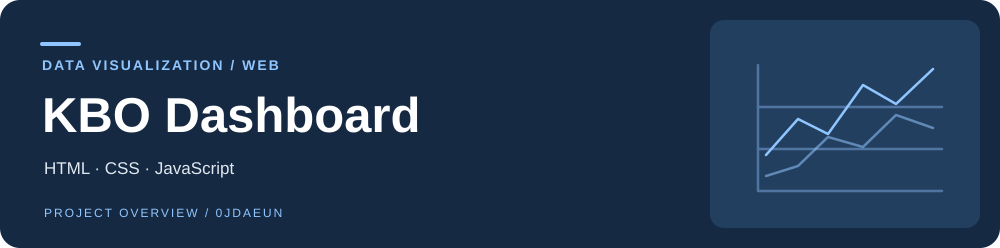

# 2026 KBO 승률 저장소

**야구 구단 정보와 승률 데이터를 인터랙티브하게 탐색하는 단일 HTML 웹페이지**

## 프로젝트 개요

KBO 10개 구단의 정보를 한 화면에서 탐색하고 승률 변화와 야구 입문 콘텐츠를 시각적으로 경험하는 웹페이지다.

## 구성

- 구단 및 선수 정보
- 승률 변화 그래프와 주요 변곡점 탐색
- 경기 일정 및 야구 용어 콘텐츠
- 응원 성향 테스트

## 실행

[index.html](index.html)을 브라우저에서 열어 확인한다. 외부 리소스 사용 여부에 따라 인터넷 연결이 필요할 수 있다.

별도의 백엔드나 실시간 데이터 수집 시스템은 저장소에서 확인되지 않았다. 표시된 통계·일정이 공식 최신 데이터인지 검증하지 않았으며 실시간 서비스로 소개하지 않는다.
